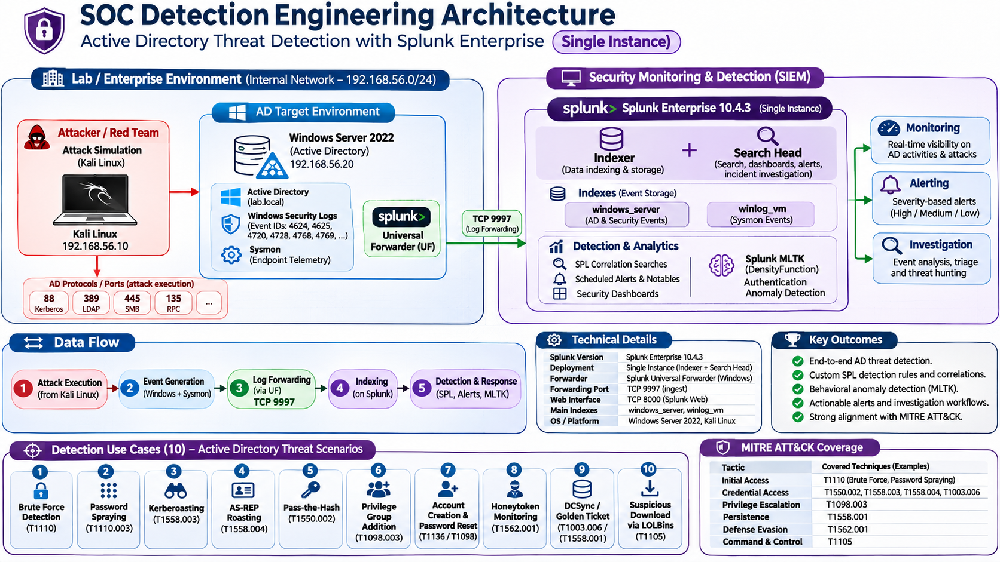

# SOC Lab — Active Directory Attack Detection with Splunk

A practical SOC detection lab demonstrating 10 Active Directory and endpoint detection use cases, plus one Splunk Machine Learning Toolkit (MLTK) anomaly-detection module.

> **Scope:** This repository is intended for an isolated, authorized lab. Do not run attack simulations against systems or accounts you do not own or administer. Use disposable test accounts, test credentials, and a non-production domain.

## Lab architecture

 


## Detection catalogue

| ID | Use case | Main telemetry | MITRE ATT&CK | Status in source lab |
|---|---|---|---|---|
| UC01 | Privileged Group Addition | Security 4728 / 4732 / 4756 | T1098 | Validated |
| UC02 | Password Spraying | Security 4625 (4771 / 4776 supplementary) | T1110.003 | Validated |
| UC03 | Brute Force — failures followed by success | Security 4625 + 4624 | T1110.001 | Validated |
| UC04 | Kerberoasting — RC4 service ticket | Security 4769 | T1558.003 | Validated |
| UC05 | AS-REP Roasting | Security 4768, pre-authentication type 0 | T1558.004 | Proposed; validate in lab |
| UC06 | Account Creation and Password Reset | Security 4720 / 4724 / 4624 | T1136.002 / T1098 | Validated |
| UC07 | Honeytoken interaction | Security 4624 / 4625 / 4768 / 4769 | Cross-technique | Validated |
| UC08 | Pass-the-Hash | Security 4624, NTLM, logon type 3 | T1550.002 | Validated |
| UC09 | Golden Ticket / DCSync | Security 4662 / 4768 / 4769 | T1558.001 / T1003.006 | Scenario validated; detection limitations documented |
| UC10 | Suspicious Download via LOLBin | Sysmon 11 (plus 1 / 3 / 22 for investigation) | T1105 | Lab fiche documented |
| ML | Authentication-failure anomaly detection | Security 4625 | T1110 (complementary) | Fit/apply workflow validated; baseline immature |

The catalogue follows the project architecture diagram. UC05 is included because it is part of the planned 10-use-case design; its procedure must be independently validated before being represented as a confirmed lab result.

## Repository structure

```text
.
├── README.md
├── docs/
│   ├── ARCHITECTURE.md
│   ├── LAB-SETUP.md
│   ├── ALERT-CONFIGURATION.md
│   ├── VALIDATION-AND-EVIDENCE.md
│   └── use-cases/
│       ├── UC01-privileged-group-addition.md
│       ├── UC02-password-spraying.md
│       ├── UC03-brute-force.md
│       ├── UC04-kerberoasting.md
│       ├── UC05-asrep-roasting.md
│       ├── UC06-account-creation-password-reset.md
│       ├── UC07-honeytoken.md
│       ├── UC08-pass-the-hash.md
│       ├── UC09-golden-ticket-dcsync.md
│       ├── UC10-suspicious-download-lolbin.md
│       └── ML-authentication-anomaly-detection.md
├── configs/
│   ├── inputs-windows-server.conf
│   ├── outputs-universal-forwarder.conf.example
│   ├── indexes.conf.example
│   └── sysmon-collection.conf
├── scripts/
│   ├── enable-auditing.ps1
│   └── verify-event-collection.ps1
└── screenshots/
    └── README.md
```

## Quick start

1. Build an isolated Windows Server 2022 Active Directory domain named `lab.local`.
2. Install Sysmon and the Splunk Universal Forwarder on the Windows host.
3. Configure the forwarder to collect the Security and Sysmon Operational channels.
4. Configure Splunk Enterprise to receive forwarded events on TCP 9997 and create the `windows_server` and `winlog_vm` indexes.
5. Enable the required Windows audit subcategories.
6. Run one use case at a time using disposable lab identities.
7. Verify the raw Windows event before running the final SPL detection.
8. Capture the evidence listed in each use-case document.
9. Configure scheduled alerts only after the search has been validated.

See [Lab Setup](docs/LAB-SETUP.md), [Architecture](docs/ARCHITECTURE.md), and [Alert Configuration](docs/ALERT-CONFIGURATION.md).

## Important implementation notes

- The Windows Security channel is indexed as `windows_server`.
- Sysmon Operational events are indexed as `winlog_vm` in this lab.
- The documented Splunk receiving port is TCP `9997`.
- Field extraction depends on the installed Microsoft Windows Add-on and the event format. Confirm actual field names with `table`, `fieldsummary`, and raw event inspection before relying on a detection.
- The `Account_Name` field can be multivalue in this environment. Several detections intentionally use `mvindex(Account_Name, 0)` or `mvindex(Account_Name, -1)`.
- A detection result is not automatically proof of malicious activity. Investigate context, authorized changes, source host, account ownership, and maintenance windows.
- Do not commit real passwords, NTLM hashes, Kerberos tickets, private IP inventories, domain SIDs, or sensitive screenshots. Use placeholders and sanitized evidence.

## Project outputs

- Scheduled Active Directory detection alerts.
- Scheduled LOLBin detection alert.
- SPL detection searches and investigation queries.
- Use-case documentation and validation evidence.
- MLTK anomaly model workflow.
- Risk-Based Alerting is a planned enhancement, not an implemented project output.
