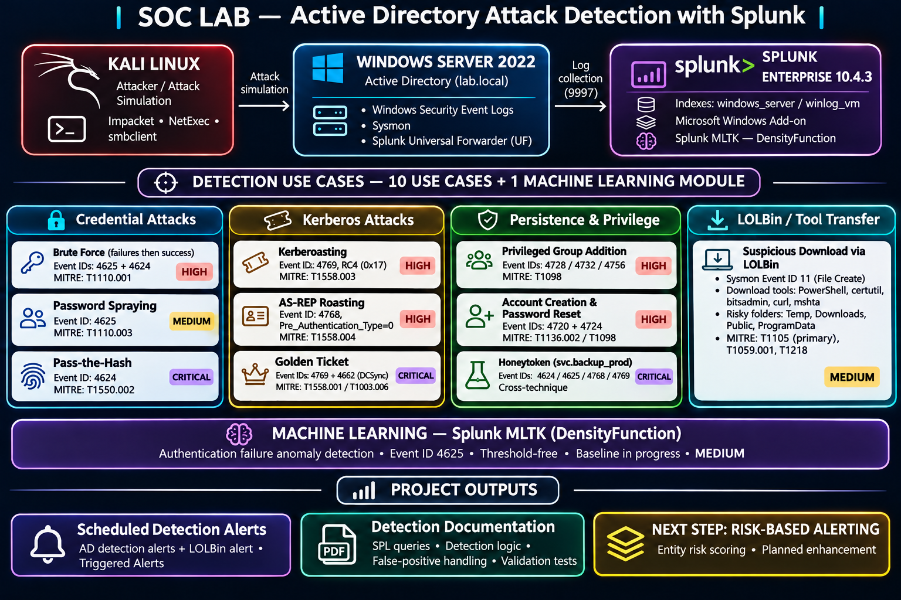

# Lab Architecture

## Components

| Component | Role | Configuration in this project |
|---|---|---|
| Kali Linux | Controlled attack simulation host | Impacket, NetExec, smbclient |
| Windows Server 2022 | Active Directory domain controller / event source | `lab.local`, Security auditing, Sysmon |
| Splunk Universal Forwarder | Windows event collection and forwarding | Security + Sysmon Operational |
| Splunk Enterprise 10.4.3 | Search, detection, scheduled alerts, dashboards | TCP receiving port 9997 |
| Microsoft Windows Add-on | Windows event field extractions | Validate extracted field names |
| Splunk MLTK | Statistical anomaly detection | DensityFunction |

 
 
## Event flow

1. A test operator runs a controlled simulation from Kali Linux or Windows PowerShell.
2. Active Directory or Windows records the corresponding event in the Security log. Sysmon records selected endpoint activity in its Operational log.
3. The Splunk Universal Forwarder monitors the configured channels.
4. The forwarder sends events to Splunk Enterprise over the configured receiving port.
5. Splunk stores Security events in `windows_server` and Sysmon events in `winlog_vm`.
6. SPL searches identify the behavior and return investigation fields.
7. Scheduled searches create triggered alerts when their result conditions are met.

## Network and collection checks

- Confirm TCP 9997 is reachable from the Windows host to Splunk.
- Confirm the Splunk receiver is enabled on TCP 9997.
- Confirm the Universal Forwarder is configured with the correct deployment/receiver destination.
- Confirm the host is sending events and the expected indexes exist.
- Do not assume that an event is absent until collection, time range, index, source, and audit policy have all been checked.

## Data sources

### Windows Security

Common events used in this project:

| Event ID | Meaning |
|---:|---|
| 4624 | Successful logon |
| 4625 | Failed logon |
| 4662 | An operation was performed on an Active Directory object; relevant DCSync rights can appear in Properties |
| 4720 | User account created |
| 4724 | Attempt to reset an account password |
| 4728 | Member added to a security-enabled global group |
| 4732 | Member added to a security-enabled local group |
| 4756 | Member added to a security-enabled universal group |
| 4768 | Kerberos authentication ticket (TGT) requested |
| 4769 | Kerberos service ticket requested |
| 4771 | Kerberos pre-authentication failed |
| 4776 | NTLM credential validation |

### Sysmon Operational

| Event ID | Meaning / purpose |
|---:|---|
| 1 | Process creation; useful for command-line and parent-process investigation |
| 3 | Network connection |
| 11 | File creation; primary event for the LOLBin download detection |
| 22 | DNS query |

[INSERT IMAGE HERE: Screenshot of Windows Event Viewer with the Security and Microsoft-Windows-Sysmon/Operational channels visible.]

## Design limitations

- Event IDs and fields vary with Windows version, audit policy, event rendering, and add-on field extraction.
- The project uses a simplified privileged-account naming convention in one detection. Replace it with a maintained privileged-account lookup in production.
- RC4 in Event 4769 is a useful signal in the documented Kerberoasting scenario, but RC4 alone is not conclusive proof of an attack.
- Golden Ticket detection on modern Windows Server versions is difficult. The source lab observed PAC revalidation behavior that makes a simple missing-4768 correlation unreliable.
- The MLTK model requires a representative normal-activity baseline. A model trained on a handful of test points is not production-ready.
