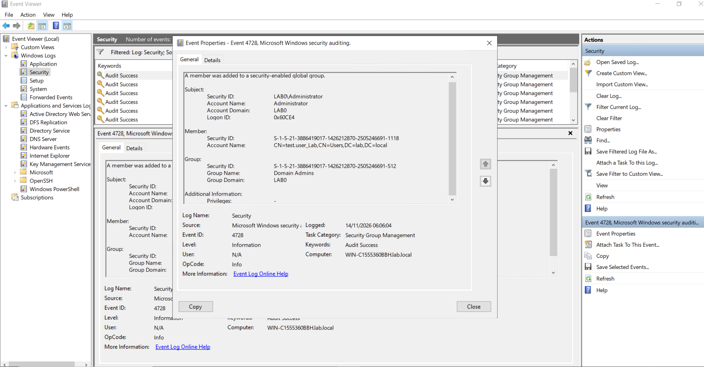
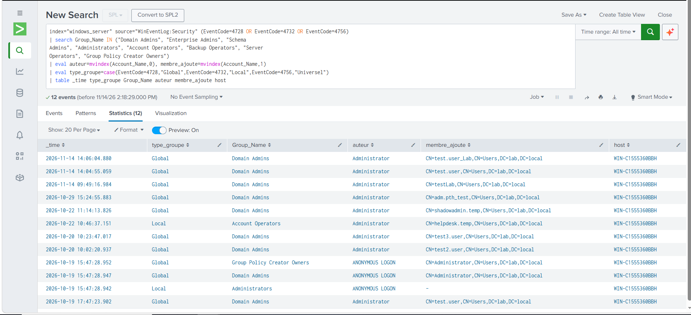
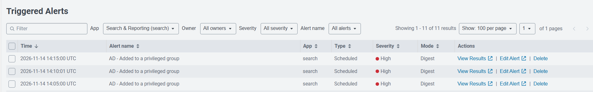

# UC01 — Privileged Group Addition

| Attribute | Value |
|---|---|
| MITRE ATT&CK | T1098 — Account Manipulation |
| Windows telemetry | 4728 (global group), 4732 (local group), 4756 (universal group) |
| Default severity | High |
| Lab status | Validated in the source lab |
| Primary index | `windows_server` |

## 1. Objective

Detect an account being added to a sensitive Active Directory group. Unexpected membership changes can enable privilege escalation or persistence.

## 2. How the detection works

The detection looks for group-membership change events and then filters the destination group against a list of privileged groups. In this lab, `Account_Name` is multivalue: index 0 is the actor and index 1 is the member added. The `Member_Name` field was observed to be empty with the installed add-on, so the query uses `mvindex`.

## 3. Prerequisites

- Domain Controller for `lab.local`.
- Splunk Universal Forwarder collecting the Security channel into `windows_server`.
- Active Directory PowerShell module.
- Audit subcategory `Security Group Management` enabled for Success and Failure.

## 4. Required configuration

```powershell
auditpol /get /subcategory:"Security Group Management"
auditpol /set /subcategory:"Security Group Management" /success:enable /failure:enable
```

Forwarder input:

```ini
[WinEventLog://Security]
disabled = 0
index = windows_server
start_from = oldest
current_only = 0
```

## 5. Step-by-step simulation

Run on the lab Domain Controller in elevated PowerShell:

```powershell
New-ADUser `
  -Name "test.user" `
  -SamAccountName "test.user" `
  -AccountPassword (ConvertTo-SecureString "P@ssw0rd123!" -AsPlainText -Force) `
  -Enabled $true

Add-ADGroupMember -Identity "Domain Admins" -Members "test.user"
```

The group addition is the test action. Do not use a real administrator account.

## 6. Verify the Windows event

```powershell
Get-WinEvent -FilterHashtable @{
    LogName = 'Security'
    Id = 4728,4732,4756
    StartTime = (Get-Date).AddMinutes(-10)
} | Select-Object TimeCreated, Id, Message
```

## 7. Splunk detection query

```spl
index="windows_server" source="WinEventLog:Security"
(EventCode=4728 OR EventCode=4732 OR EventCode=4756)
| search Group_Name IN (
    "Domain Admins", "Enterprise Admins", "Schema Admins",
    "Administrators", "Account Operators", "Backup Operators",
    "Server Operators", "Group Policy Creator Owners"
)
| eval author=mvindex(Account_Name,0),
       added_member=mvindex(Account_Name,1)
| eval group_type=case(
    EventCode=4728,"Global",
    EventCode=4732,"Local",
    EventCode=4756,"Universal"
)
| table _time group_type Group_Name author added_member host
```

## 8. Expected results

Expected test result:
- Event ID: `4728`.
- Group: `Domain Admins`.
- Actor: the account that performed the group change (commonly `Administrator` in the lab).
- Added member: `test.user` (may appear as a distinguished name).
- Splunk returns one matching row for the controlled addition.

## 9. Scheduled alert

- Name: `AD - Privileged Group Addition`.
- Type: Scheduled.
- Cron: `*/5 * * * *`.
- Time range: Last 5 minutes.
- Trigger: Number of results > 0.
- Action: Add to Triggered Alerts.
- Severity: High.

## 10. Limitations and false positives

- Group additions can be legitimate administration. Confirm the change ticket and actor.
- The privileged group list must match the actual domain and local group naming.
- The lab observed a false positive during domain-controller promotion (`ANONYMOUS LOGON`); investigate and tune rather than blindly suppressing.
- Consider monitoring removals too: 4729, 4733, and 4757.

## 11. Cleanup

```powershell
Remove-ADGroupMember -Identity "Domain Admins" -Members "test.user" -Confirm:$false
Disable-ADAccount -Identity "test.user"
Remove-ADUser -Identity "test.user" -Confirm:$false
```

## 12. Screenshot checklist

### Event 4728 – PowerShell showing creation of test.user_LAB and addition to Domain Admins

 
  
### Event 4728 – Event Viewer Security event 4728

 
  
### Splunk search showing the matching event

 

### Triggered Alerts entry for AD - Privileged Group Additio

 
  
## 13. Validation status

Record the actual test date, Windows version, Splunk version, source host, observed Event IDs, number of returned results, and alert status. Do not mark a scenario validated until the complete event-to-alert chain has been demonstrated.
