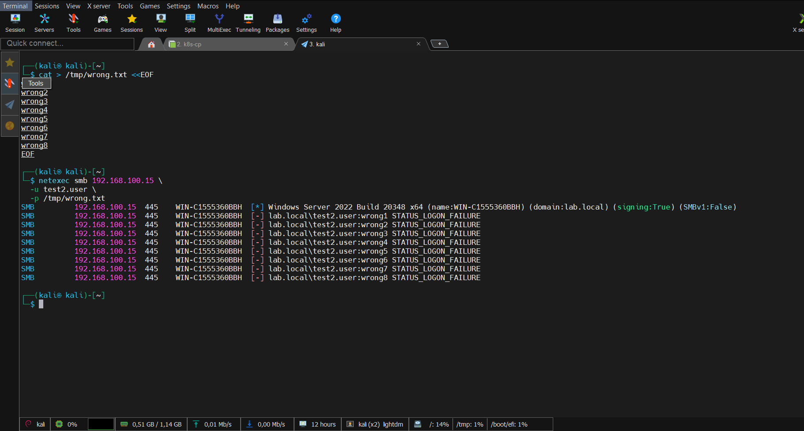
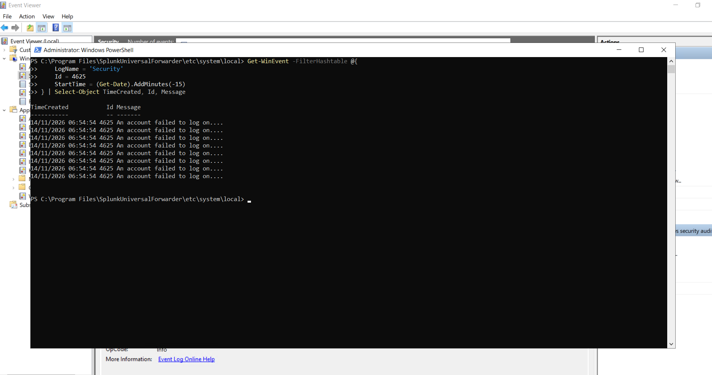
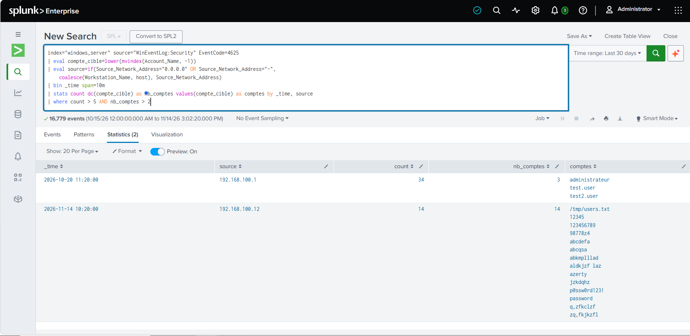
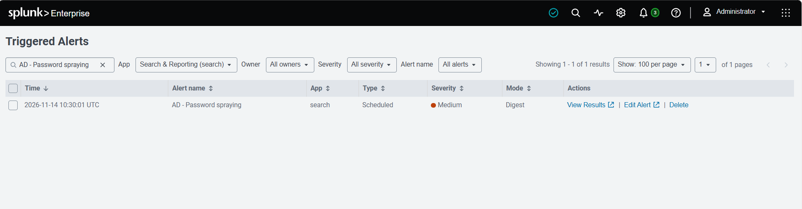

# UC02 — Password Spraying

| Attribute | Value |
|---|---|
| MITRE ATT&CK | T1110.003 — Password Spraying |
| Windows telemetry | 4625 (primary); 4771 and 4776 can supplement |
| Default severity | Medium |
| Lab status | Validated in the source lab |
| Primary index | `windows_server` |

## 1. Objective

Detect one source producing failed logons against multiple distinct accounts in a short period. Password spraying distributes guesses across users instead of repeatedly attacking only one account.

## 2. How the detection works

The SPL extracts the target account from the last value in multivalue `Account_Name`, normalizes case, and groups failures by source and 10-minute time bucket. The lab threshold is more than five failures against more than two distinct accounts.

## 3. Prerequisites

- Domain Controller Security events forwarded to `windows_server`.
- Audit `Logon`, `Credential Validation`, and `Kerberos Authentication Service` for Success and Failure.
- Kali Linux with NetExec (`netexec`).
- Disposable test accounts. Confirm the account-lockout policy before testing.

## 4. Required configuration

```powershell
auditpol /set /subcategory:"Logon" /success:enable /failure:enable
auditpol /set /subcategory:"Credential Validation" /success:enable /failure:enable
auditpol /set /subcategory:"Kerberos Authentication Service" /success:enable /failure:enable
```

## 5. Step-by-step simulation

On Kali, create a small password list:

```bash
cat > /tmp/wrong.txt <<'EOF'
wrong1
wrong2
wrong3
wrong4
wrong5
wrong6
wrong7
wrong8
EOF
```

Use only dedicated lab accounts and a controlled number of attempts. Example:

```bash
netexec smb <DC_IP> -u test2.user -p /tmp/wrong.txt
```

Repeat against two or more disposable accounts from the same source to generate the multi-account pattern. Stop if the domain lockout threshold is approached.

## 6. Verify the Windows event

```powershell
Get-WinEvent -FilterHashtable @{
    LogName = 'Security'
    Id = 4625
    StartTime = (Get-Date).AddMinutes(-15)
} | Select-Object TimeCreated, Id, Message
```

## 7. Splunk detection query

```spl
index="windows_server" source="WinEventLog:Security" EventCode=4625
| eval target_account=lower(mvindex(Account_Name,-1))
| eval source=if(
    Source_Network_Address="0.0.0.0" OR Source_Network_Address="-",
    coalesce(Workstation_Name,host),
    Source_Network_Address
)
| bin _time span=10m
| stats count as failures
        dc(target_account) as distinct_accounts
        values(target_account) as accounts
        by _time source
| where failures > 5 AND distinct_accounts > 2
| table _time source failures distinct_accounts accounts
```

## 8. Expected results

Expected:
- Multiple Event 4625 records from one source.
- More than two distinct target accounts.
- More than five failures in the same 10-minute bucket.
- The source lab recorded 35 Event 4625 records during a 15-minute test period.

## 9. Scheduled alert

- Name: `AD - Password Spraying`.
- Type: Scheduled.
- Cron: `*/10 * * * *`.
- Time range: Last 10 minutes.
- Trigger: Number of results > 0.
- Action: Add to Triggered Alerts.
- Severity: Medium.

## 10. Limitations and false positives

- Fixed `bin` buckets can split an attack that crosses a bucket boundary. A rolling-window design using `streamstats` can improve this.
- Exclude known scanners and authorized validation systems with a maintained allowlist.
- Windows may render the built-in administrator as `Administrateur`.
- The source address may be `0.0.0.0` or `-` for some logon paths; the query falls back to workstation or host.
- Keep thresholds aligned with account lockout and business activity.

## 11. Cleanup

Delete `/tmp/wrong.txt` from Kali after the test. No AD account changes are required if existing disposable test accounts were used.

## 12. Screenshot checklist

### Kali terminal showing the NetExec test against a lab DC and test accounts
 

### Event Viewer Security event 4625 with source address and target account visible
 

 ### Splunk result
 

 ### Triggered Alerts entry for Password Spraying
 

