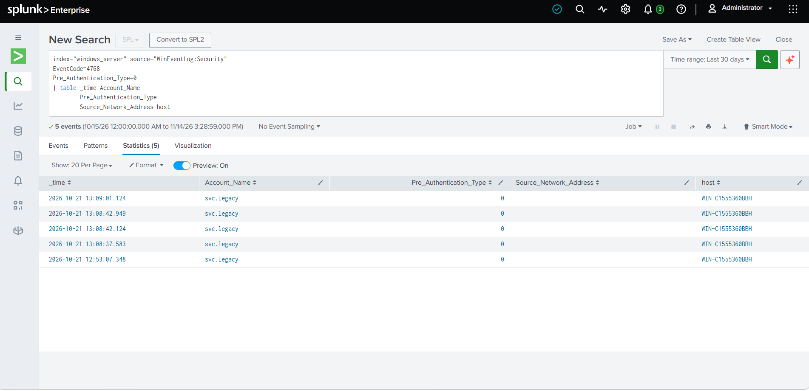

# UC05 — AS-REP Roasting

| Attribute | Value |
|---|---|
| MITRE ATT&CK | T1558.004 — AS-REP Roasting |
| Windows telemetry | Event 4768; pre-authentication type 0 |
| Proposed severity | High |
| Lab status | **Proposed procedure — not confirmed as validated in the available source documentation** |
| Primary index | `windows_server` |

## 1. Objective

Detect Kerberos TGT requests for accounts that do not require Kerberos pre-authentication. Such accounts may allow an unauthenticated requester to obtain AS-REP material that can be attacked offline.

## 2. How the detection works

The intended signal is Event 4768 with `Pre_Authentication_Type=0`. The field extraction and event behavior must be confirmed on the actual Windows Server version and Splunk Windows Add-on before treating the search as operational.

## 3. Prerequisites

- Isolated `lab.local` domain.
- Disposable test account.
- Security log collection to `windows_server`.
- Kerberos Authentication Service auditing enabled.
- Kali with the Impacket `GetNPUsers` utility.
- Time synchronization and domain DNS functioning.

## 4. Required configuration

On the lab Domain Controller:

```powershell
auditpol /get /subcategory:"Kerberos Authentication Service"
auditpol /set /subcategory:"Kerberos Authentication Service" /success:enable /failure:enable
```

Create a disposable test user and deliberately enable the no-preauthentication setting for this test account only:

```powershell
New-ADUser `
  -Name "asrep.test" `
  -SamAccountName "asrep.test" `
  -AccountPassword (ConvertTo-SecureString "AsrepTest2026!" -AsPlainText -Force) `
  -Enabled $true

Set-ADAccountControl -Identity "asrep.test" -DoesNotRequirePreAuth $true

Get-ADUser asrep.test -Properties DoesNotRequirePreAuth |
  Select-Object SamAccountName, DoesNotRequirePreAuth
```

## 5. Step-by-step simulation

Create a username file on Kali:

```bash
printf '%s\n' 'asrep.test' > users.txt
```

Request AS-REP responses from the lab domain:

```bash
GetNPUsers.py lab.local/ \
  -dc-ip <DC_IP> \
  -usersfile users.txt \
  -no-pass
```

Use only the disposable test identity and do not publish any returned hash material.

## 6. Verify the Windows event

```powershell
Get-WinEvent -FilterHashtable @{
    LogName = 'Security'
    Id = 4768
    StartTime = (Get-Date).AddMinutes(-15)
} | Select-Object TimeCreated, Id, Message
```

Inspect the event XML/details and confirm whether pre-authentication type 0 is recorded and how the Splunk Add-on extracts it.

## 7. Splunk detection query

First validate the field and value representation:

```spl
index="windows_server" source="WinEventLog:Security" EventCode=4768
| fieldsummary
```

Candidate detection, subject to field validation:

```spl
index="windows_server" source="WinEventLog:Security" EventCode=4768
| where Pre_Authentication_Type=0
| table _time Account_Name Pre_Authentication_Type
        Source_Network_Address host
```

If the field is absent or encoded differently, inspect the raw event and adapt the query. Do not silently assume the field exists.

## 8. Expected results

Expected behavior to validate:
- The test account has `DoesNotRequirePreAuth=True` during the test.
- A request is made for `asrep.test`.
- The Domain Controller records the relevant Kerberos event.
- The event indicates no pre-authentication (type 0).
- Splunk extracts the field and returns the expected account and source.

This is an expected test plan, not a recorded result from the available project evidence.

## 9. scheduled alert

After validation:
- Name: `AD - AS-REP Roasting`.
- Type: Scheduled.
- Proposed cron: `*/15 * * * *`.
- Proposed time range: Last 15 minutes.
- Trigger: Number of results > 0.
- Action: Add to Triggered Alerts.
- Severity: High.

## 12. Screenshot checklist

### Splunk candidate detection results

 
