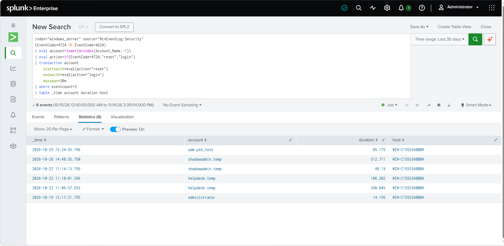

# UC06 — Account Creation and Password Reset

| Attribute | Value |
|---|---|
| MITRE ATT&CK | T1136.002 — Create Account: Domain Account; T1098 — Account Manipulation |
| Windows telemetry | 4720 (account created), 4724 (password reset by another account), 4624 (successful logon) |
| Default severity | Medium for unusual creation; High for reset followed by logon |
| Lab status | Validated in the source lab |
| Primary index | `windows_server` |

## 1. Objective

Detect account creation by an actor outside the known administrator allowlist and detect a password reset followed by a rapid successful logon to the same target account.

## 2. How the detection works

The first analytic filters Event 4720 based on the actor. The second correlates Event 4724 with Event 4624 for the same target account within 30 minutes. In this lab, the actor and target can both be represented in multivalue `Account_Name`; `mvindex` is used because `Target_Account_Name` was observed to be empty.

## 3. Prerequisites

- Domain Controller with Security log forwarding.
- Audit `User Account Management` and `Logon` for Success and Failure.
- Disposable test accounts.
- A known allowlist of approved account administrators.

## 4. Required configuration

```powershell
auditpol /get /subcategory:"User Account Management"
auditpol /set /subcategory:"User Account Management" /success:enable /failure:enable
auditpol /set /subcategory:"Logon" /success:enable /failure:enable
```

## 5. Step-by-step simulation

Create a disposable account:

```powershell
New-ADUser `
  -Name "ghost.user" `
  -SamAccountName "ghost.user" `
  -AccountPassword (ConvertTo-SecureString "Temp123!" -AsPlainText -Force) `
  -Enabled $true
```

Reset its password:

```powershell
Set-ADAccountPassword `
  -Identity "ghost.user" `
  -NewPassword (ConvertTo-SecureString "Hacked456!" -AsPlainText -Force) `
  -Reset
```

To test an unusual actor, use a dedicated test administrator and `-Credential`:

```powershell
$cred = Get-Credential
New-ADUser `
  -Name "suspect3.user" `
  -SamAccountName "suspect3.user" `
  -AccountPassword (ConvertTo-SecureString "Temp123!" -AsPlainText -Force) `
  -Enabled $true `
  -Credential $cred
```

Verify the account exists with `Get-ADUser suspect3.user`.

## 6. Verify the Windows event

```powershell
Get-WinEvent -FilterHashtable @{
    LogName = 'Security'
    Id = 4720,4724,4624
    StartTime = (Get-Date).AddMinutes(-30)
} | Select-Object TimeCreated, Id, Message
```

## 7. Splunk detection query

```spl
**A. Account creation by an unexpected actor**

```spl
index="windows_server" source="WinEventLog:Security" EventCode=4720
| eval author=mvindex(Account_Name,0),
       new_account=mvindex(Account_Name,-1)
| where NOT match(author,"(?i)^(administrator|administrateur|svc\.iam)$")
| table _time author new_account host
```

**B. Password reset followed by successful logon**

```spl
index="windows_server" source="WinEventLog:Security"
(EventCode=4724 OR EventCode=4624)
| eval account=lower(mvindex(Account_Name,-1))
| eval action=if(EventCode=4724,"reset","login")
| transaction account
    startswith=eval(action="reset")
    endswith=eval(action="login")
    maxspan=30m
| where eventcount=2
| table _time account duration host
```

## 8. Scheduled alert

Alert A — Unusual account creation:
- Scheduled; cron `*/10 * * * *`; Last 10 minutes; results > 0; Medium.

Alert B — Password reset followed by logon:
- Scheduled; cron `*/10 * * * *`; Last 30 minutes; results > 0; High.

Both use Add to Triggered Alerts.


## 9. Screenshot checklist

- [INSERT IMAGE HERE: Splunk transaction result showing reset-to-login duration.]

### Splunk Result :

 
