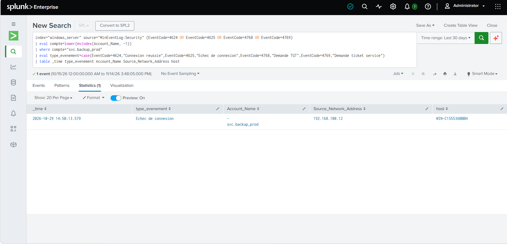

# UC07 — Honeytoken Interaction :

| Attribute | Value |
|---|---|
| MITRE ATT&CK | Cross-technique detection; related to T1087 (Account Discovery), T1021 (Remote Services), and T1558.003 (Kerberoasting) |
| Windows telemetry | 4624, 4625, 4768, 4769 |
| Default severity | Critical |
| Lab status | Validated in the source lab |
| Primary index | `windows_server` |

## 1. Objective

Detect any authentication or Kerberos activity involving a decoy service account that should never be used. The expected legitimate activity level is zero, so even one interaction warrants investigation.

## 2. How the detection works

Unlike threshold-based detections, the honeytoken relies on a known-unused identity. The query matches the account across successful logons, failed logons, TGT requests, and service-ticket requests. A failed attempt is sufficient to trigger the detection.

## 3. Prerequisites

- Domain Controller and Security event collection.
- Audit Logon, Kerberos Authentication Service, and Kerberos Service Ticket Operations.
- A dedicated decoy account with a long, random password that is never used by administrators or applications.
- Keep the identity of the honeytoken confidential.

## 4. Required configuration

```powershell
auditpol /set /subcategory:"Logon" /success:enable /failure:enable
auditpol /set /subcategory:"Kerberos Authentication Service" /success:enable /failure:enable
auditpol /set /subcategory:"Kerberos Service Ticket Operations" /success:enable /failure:enable
```

## 5. Step-by-step simulation

Create the honeytoken:

```powershell
New-ADUser `
  -Name "svc.backup_prod" `
  -SamAccountName "svc.backup_prod" `
  -AccountPassword (ConvertTo-SecureString "<LONG_RANDOM_UNUSED_PASSWORD>" -AsPlainText -Force) `
  -Enabled $true `
  -Description "Service account - production backup"
```

Optionally add an SPN to make the decoy visible during service-account enumeration:

```powershell
setspn -A HTTP/backup-prod.lab.local svc.backup_prod
```

From Kali, make one failed authentication attempt:

```bash
netexec smb <DC_IP> -u svc.backup_prod -p '<INCORRECT_TEST_PASSWORD>'
```

## 6. Verify the Windows event

```powershell
Get-WinEvent -FilterHashtable @{
    LogName = 'Security'
    Id = 4624,4625,4768,4769
    StartTime = (Get-Date).AddMinutes(-10)
} | Select-Object TimeCreated, Id, Message
```

## 7. Splunk detection query

```spl
index="windows_server" source="WinEventLog:Security"
(EventCode=4624 OR EventCode=4625 OR EventCode=4768 OR EventCode=4769)
| eval account=lower(mvindex(Account_Name,-1))
| where account="svc.backup_prod"
| eval event_type=case(
    EventCode=4624,"Successful logon",
    EventCode=4625,"Failed logon",
    EventCode=4768,"TGT request",
    EventCode=4769,"Service ticket request"
)
| table _time event_type Account_Name Source_Network_Address host
```

## 8. Scheduled alert

- Name: `AD - Honeytoken svc.backup_prod Touched`.
- Scheduled; cron `*/5 * * * *`.
- Time range: Last 5 minutes.
- Trigger: Number of results > 0.
- Action: Add to Triggered Alerts.
- Severity: Critical.

## 9. Screenshot checklist

### Splunk result

 
  

