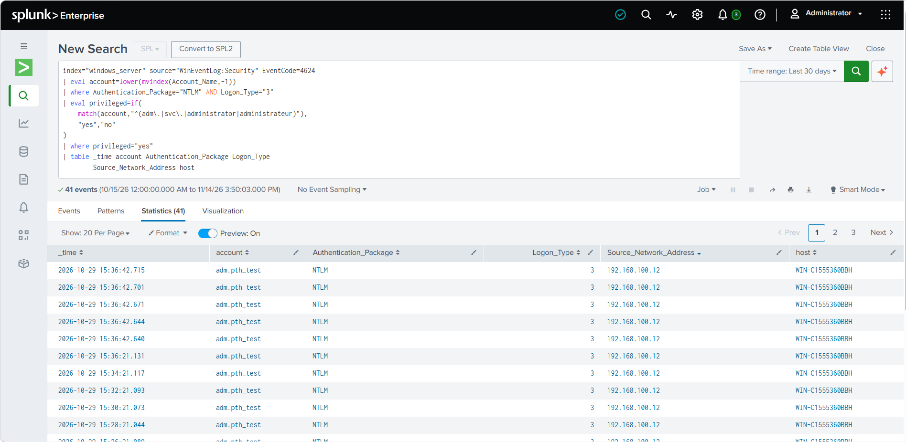

# UC08 — Pass-the-Hash

| Attribute | Value |
|---|---|
| MITRE ATT&CK | T1550.002 — Use Alternate Authentication Material: Pass the Hash |
| Windows telemetry | 4624 — successful network logon, Logon Type 3 |
| Default severity | Critical |
| Lab status | Validated in the source lab |
| Primary index | `windows_server` |

## 1. Objective

Detect successful NTLM network authentication by an account identified as privileged. The analytic uses the combination of NTLM, network logon type 3, and a privileged-account indicator rather than treating every NTLM event as malicious.

## 2. How the detection works

Pass-the-Hash uses an NTLM hash as authentication material rather than the clear-text password. The lab test used Impacket `wmiexec.py` with a test account. The search filters Event 4624 for `Authentication_Package=NTLM` and `Logon_Type=3`, then applies a simplified privileged-account naming convention.

## 3. Prerequisites

- Disposable test account.
- Account is temporarily added to Domain Admins in the isolated lab.
- Logon auditing enabled for Success and Failure.
- Kali with Impacket.
- Do not use real account hashes.

## 4. Required configuration

Create the test account on Windows:

```powershell
New-ADUser `
  -Name "adm.pth_test" `
  -SamAccountName "adm.pth_test" `
  -AccountPassword (ConvertTo-SecureString "PtHtest2026!" -AsPlainText -Force) `
  -Enabled $true

Add-ADGroupMember -Identity "Domain Admins" -Members "adm.pth_test"
```

Logon auditing:

```powershell
auditpol /set /subcategory:"Logon" /success:enable /failure:enable
```

## 5. Step-by-step simulation

On Kali, calculate the NTLM hash for the disposable lab password:

```bash
python3 -c "from impacket.ntlm import compute_nthash; print(compute_nthash('PtHtest2026!').hex())"
```

Use the resulting lab-only hash in the controlled authentication test:

```bash
wmiexec.py -hashes :<HASH_NTLM> lab.local/adm.pth_test@<DC_IP>
```

Do not paste a real hash into documentation, screenshots, or Git history.

## 6. Verify the Windows event

```powershell
Get-WinEvent -FilterHashtable @{
    LogName = 'Security'
    Id = 4624
    StartTime = (Get-Date).AddMinutes(-10)
} | Select-Object TimeCreated, Id, Message
```

## 7. Splunk detection query

```spl
index="windows_server" source="WinEventLog:Security" EventCode=4624
| eval account=lower(mvindex(Account_Name,-1))
| where Authentication_Package="NTLM" AND Logon_Type="3"
| eval privileged=if(
    match(account,"^(adm\.|svc\.|administrator|administrateur)"),
    "yes","no"
)
| where privileged="yes"
| table _time account Authentication_Package Logon_Type
        Source_Network_Address host
```

## 8. Expected results

Expected source-lab observation:
- Account: `adm.pth_test`.
- Authentication package: `NTLM`.
- Logon type: `3`.
- Key length: `128` in the observed event.
- A normal machine account authentication used Kerberos in the comparison sample.

## 9. Scheduled alert

- Name: `AD - Pass-the-Hash Suspected (NTLM on Privileged Account)`.
- Scheduled; cron `*/5 * * * *`.
- Time range: Last 5 minutes.
- Trigger: Number of results > 0.
- Action: Add to Triggered Alerts.
- Severity: Critical.


## 10. Screenshot checklist

### Splunk result:

 

