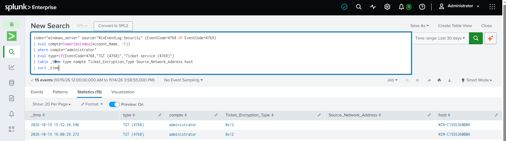

# UC09 — Golden Ticket and DCSync

| Attribute | Value |
|---|---|
| MITRE ATT&CK | T1558.001 — Golden Ticket; T1003.006 — DCSync |
| Windows telemetry | 4662 (DCSync-related directory access), 4768 / 4769 (Kerberos) |
| Severity | Critical |
| Lab status | End-to-end scenario documented as validated; direct detection limitations observed on Windows Server 2019/2022 |
| Primary index | `windows_server` |

## 1. Objective

Demonstrate the risk of compromise of the `krbtgt` account secret and detect the preceding DCSync activity. The most reliable detection point in this lab is the unauthorized replication-rights activity, rather than relying exclusively on a classic Golden Ticket event sequence.

## 2. How the detection works

A Golden Ticket is a forged Kerberos TGT created using the `krbtgt` account secret. DCSync can be used by an appropriately privileged identity to request directory replication data, including the `krbtgt` secret.

This project uses two detection approaches:

2. **RC4 Event 4769 anomaly:** identify RC4 service-ticket encryption (`0x17`) where RC4 is unexpected.

The source lab observed that a simple “4769 without a matching 4768” approach was unreliable on Windows Server 2019/2022 because PAC revalidation can generate a 4768 event for a forged ticket.

## 3. Prerequisites

- Isolated lab domain.
- Disposable privileged lab identity.
- Audit for Kerberos Authentication Service, Kerberos Service Ticket Operations, and Directory Service Access.
- Appropriate SACL on the domain naming context to audit relevant replication-rights access.
- Kali with Impacket.
- Accurate lab domain SID and time synchronization.
- Never use a production `krbtgt` secret or publish extracted secrets.

## 4. Required configuration

On the Domain Controller:

```powershell
auditpol /set /subcategory:"Kerberos Service Ticket Operations" /success:enable /failure:enable
auditpol /set /subcategory:"Kerberos Authentication Service" /success:enable /failure:enable
auditpol /set /subcategory:"Directory Service Access" /success:enable /failure:enable
```

**Important:** Configure and verify an appropriate SACL for the replication permissions on the domain naming context. Without the required object auditing, the desired Event 4662 may not be generated.

## 5. Step-by-step lab scenario

### Step 1 — Controlled DCSync validation

From Kali, use only the dedicated privileged lab account:

```bash
secretsdump.py -just-dc-user krbtgt \
  lab.local/<LAB_ADMIN>:'<LAB_PASSWORD>'@<DC_IP>
```

This operation can return highly sensitive credential material. Do not copy the output into GitHub, screenshots, tickets, or shared logs. In public evidence, redact all hashes and keys.

### Step 2 — Kerberos client configuration

Example `/etc/krb5.conf` realm settings:

```ini
[libdefaults]
    default_realm = LAB.LOCAL
    dns_lookup_realm = false
    dns_lookup_kdc = true
    rdns = false

[realms]
    LAB.LOCAL = {
        kdc = <DC_IP>
        admin_server = <DC_IP>
        default_domain = lab.local
    }

[domain_realm]
    .lab.local = LAB.LOCAL
    lab.local = LAB.LOCAL
```

### Step 3 — Ticket validation evidence

The source lab used Impacket ticket tooling and observed a ticket lifetime substantially longer than a normal Kerberos ticket, with RC4 shown by the Kali `klist -e` output.

For a public repository, show a sanitized ticket metadata capture only. Do not publish the `krbtgt` hash, forged ticket cache, or reusable ticket material.

### Step 4 — Validate ticket use

The source lab used SMB access with a Kerberos cache and successfully reached an SMB prompt. Do not include reusable ticket files in the repository. If reproducing this step, use only the isolated lab and keep the ticket cache private.

## 6. Verify Windows events

```powershell
Get-WinEvent -FilterHashtable @{
    LogName = 'Security'
    Id = 4662,4768,4769
    StartTime = (Get-Date).AddMinutes(-30)
} | Select-Object TimeCreated, Id, Message
```

Inspect Event 4662's `Properties` and confirm that the relevant replication-rights GUIDs are present.


### B. SPL

```spl
index="windows_server" source="WinEventLog:Security" (EventCode=4768 OR EventCode=4769)
| eval compte=lower(mvindex(Account_Name, -1))
| where compte="administrator"
| eval type=if(EventCode=4768,"TGT (4768)","Ticket service (4769)")
| table _time type compte Ticket_Encryption_Type Source_Network_Address host
| sort _time
```

# 9. Scheduled alert

- Name: `AD - Golden Ticket (DCSync / RC4 Anomaly)`.
- Type: Scheduled.
- Cron: `*/15 * * * *`.
- Time range: Last 15 minutes.
- Trigger: Number of results > 0.
- Action: Add to Triggered Alerts.
- Severity: Critical.

Consider separate alerts for DCSync and RC4 anomalies so the alert title accurately describes the observed behavior.

## 12. Screenshot checklist

### Splunk  detection results
 
