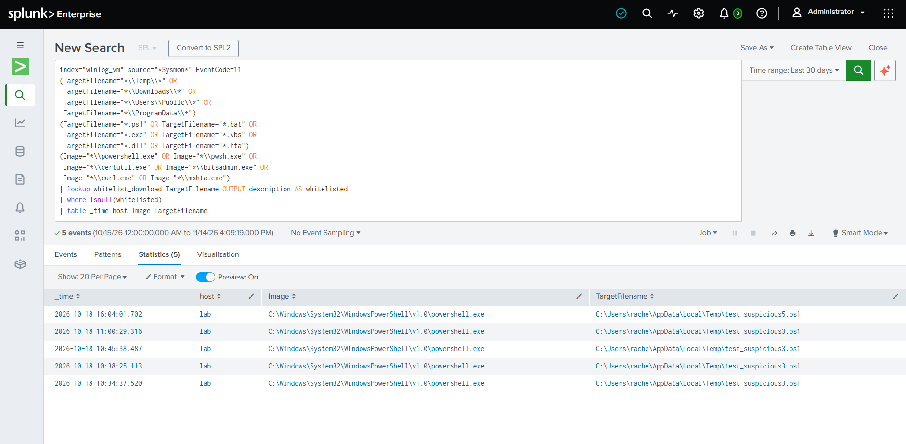
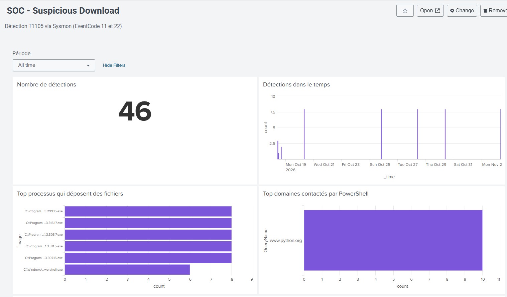
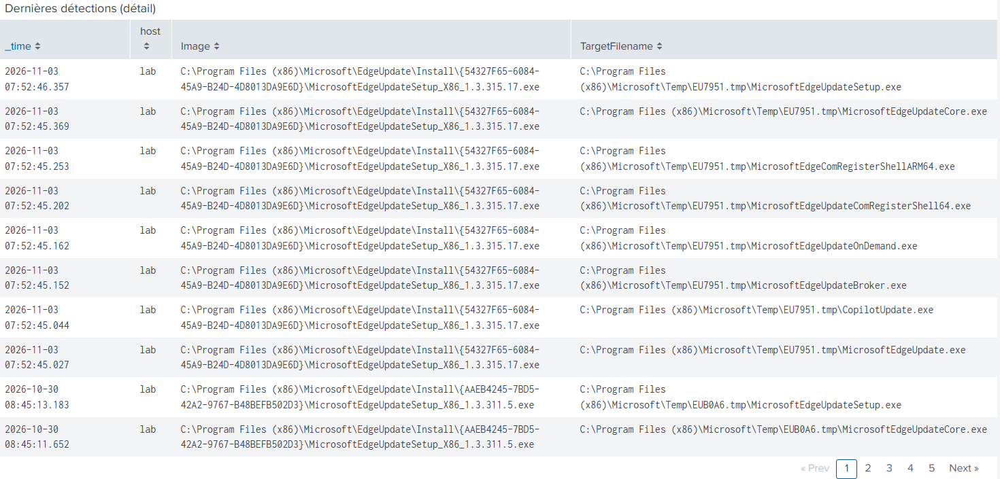

# UC10 — Suspicious Download via LOLBin

| Attribute | Value |
|---|---|
| MITRE ATT&CK | T1105 — Ingress Tool Transfer; related techniques T1059.001 (PowerShell) and T1218 (System Binary Proxy Execution) |
| Windows telemetry | Sysmon Event 11 (File Create); Events 1, 3, 22 for investigation |
| Default severity | Medium; elevate if the deposited file is executed or confirmed malicious |
| Lab status | Documented in the source lab fiche |
| Primary index | `windows_server` |

## 1. Objective

Detect a script or executable created in a risky directory by a process commonly used to download or transfer files. The primary search correlates a Sysmon file-creation event with a risky path, executable/script extension, and a download-capable process.

## 2. How the detection works

The search uses Sysmon Event 11 and filters `TargetFilename` for Temp, Downloads, Public, or ProgramData; filters extensions such as `.ps1`, `.bat`, `.exe`, `.vbs`, `.dll`, and `.hta`; and checks `Image` for PowerShell, certutil, bitsadmin, curl, or mshta. A lookup named `whitelist_download` excludes approved files.

## 3. Prerequisites

- Sysmon installed and writing to `Microsoft-Windows-Sysmon/Operational`.
- Splunk Universal Forwarder collecting Sysmon Operational into `winlog_vm`.
- `renderXml = false` as used in the source lab so `EventCode`, `Image`, and `TargetFilename` are extracted.
- Lookup `whitelist_download` configured in Splunk.

## 4. Required configuration

Universal Forwarder input:

```ini
[WinEventLog://Microsoft-Windows-Sysmon/Operational]
disabled = 0
renderXml = false
index = winlog_vm
```

The lookup should contain at least a `TargetFilename` match key and a description. Add only known-good, reviewed paths. Do not create a broad whitelist that suppresses entire directories.

## 5. Step-by-step simulation

Use a harmless test resource and do not execute the downloaded content. Example PowerShell test:

```powershell
Invoke-WebRequest `
  -Uri "https://www.python.org/robots.txt" `
  -OutFile "$env:TEMP\test_suspicious.ps1"
```

This writes an innocuous text response with a `.ps1` extension to a monitored directory to validate the file-creation detection. It is not a malicious script and should not be executed.

## 6. Verify the Windows event

```powershell
Get-WinEvent -FilterHashtable @{
    LogName = 'Microsoft-Windows-Sysmon/Operational'
    Id = 11
    StartTime = (Get-Date).AddMinutes(-10)
} | Select-Object TimeCreated, Id, Message
```

## 7. Splunk detection query

```spl
index="winlog_vm" source="*Sysmon*" EventCode=11
(TargetFilename="*\\Temp\\*" OR
 TargetFilename="*\\Downloads\\*" OR
 TargetFilename="*\\Users\\Public\\*" OR
 TargetFilename="*\\ProgramData\\*")
(TargetFilename="*.ps1" OR TargetFilename="*.bat" OR
 TargetFilename="*.exe" OR TargetFilename="*.vbs" OR
 TargetFilename="*.dll" OR TargetFilename="*.hta")
(Image="*\\powershell.exe" OR Image="*\\pwsh.exe" OR
 Image="*\\certutil.exe" OR Image="*\\bitsadmin.exe" OR
 Image="*\\curl.exe" OR Image="*\\mshta.exe")
| lookup whitelist_download TargetFilename OUTPUT description AS whitelisted
| where isnull(whitelisted)
| table _time host Image TargetFilename
```
## 8. Dashboard : SOC - Suspicious Download

This dashboard provides a centralized overview of suspicious download activities and related detection events.

| Panel | Description | Purpose |
|---|---|---|
| Detection Count | Total number of detections | Monitor suspicious download activity |
| Activity Volume Over Time | Detection volume during the selected time period | Identify activity spikes |
| Top Processes | Programs responsible for creating or dropping scripts and executables | Identify suspicious processes |
| Top PowerShell Domains | Domains contacted by PowerShell (EventCode 22) | Identify potentially suspicious external connections |
| Latest Detections | Most recent suspicious download events | Review events requiring investigation |

## 9. Expected results

Expected:
- Sysmon Event 11.
- `TargetFilename` points to a monitored risky directory and a selected extension.
- `Image` identifies one of the monitored download-capable tools.
- The file is not present in the approved whitelist.
- The source lab uses a 15-minute search window and a 5-minute schedule.

## 10. Scheduled alert

- Name: `SOC - Suspicious Download via LOLBin`.
- Type: Scheduled.
- Cron: `*/5 * * * *`.
- Time range: Last 15 minutes.
- Trigger: Number of results > 0.
- Throttle: 1 hour by `host` (as documented in the source fiche).
- Action: Add to Triggered Alerts.
- Severity: Medium; raise if execution or malicious content is confirmed.

## 11. Screenshot checklist

### Splunk detection results :

 

 ### Dashboard Screenshot :
 

 ### Dashboard : Latest Detections
 

 
